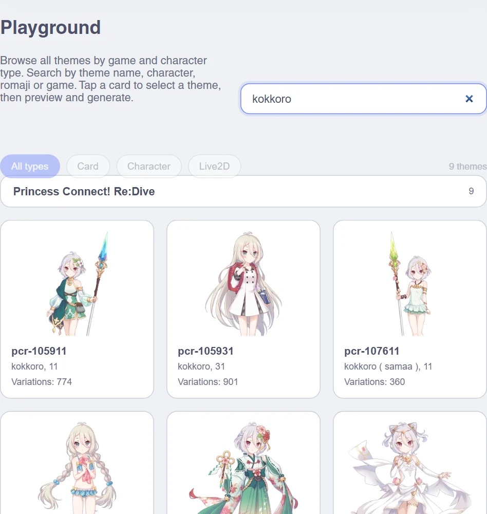
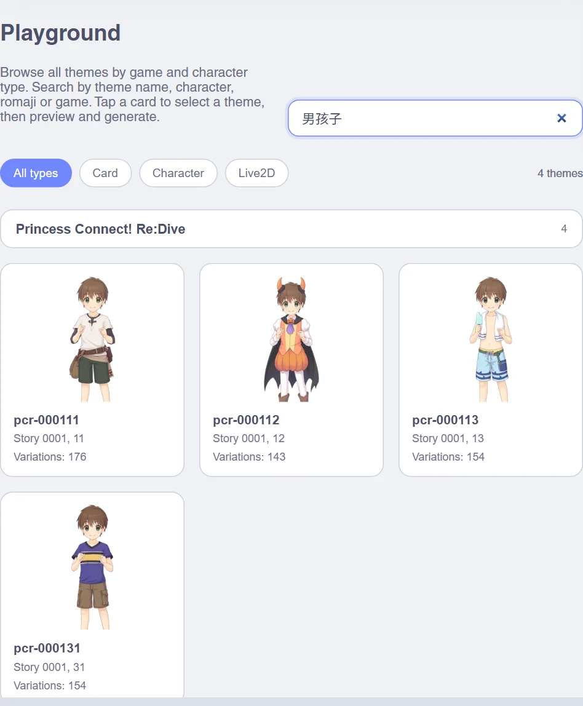
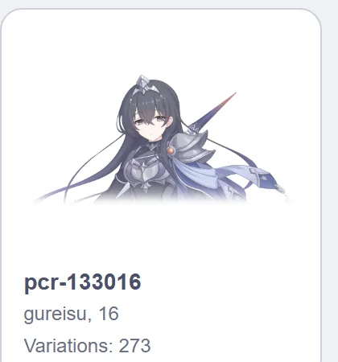
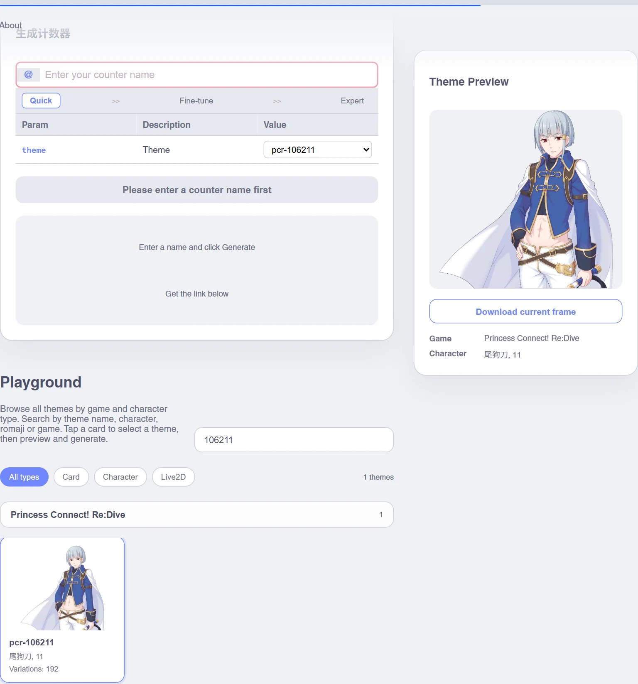
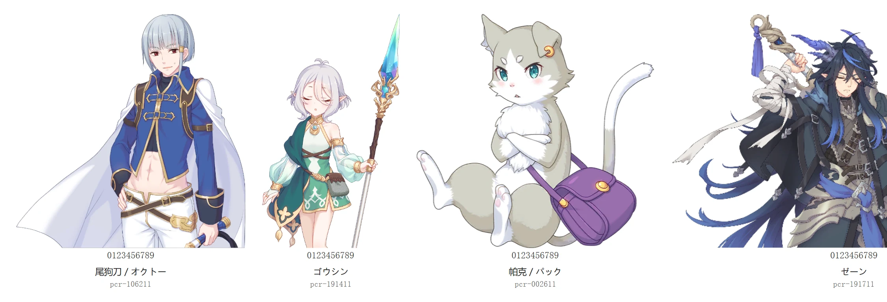
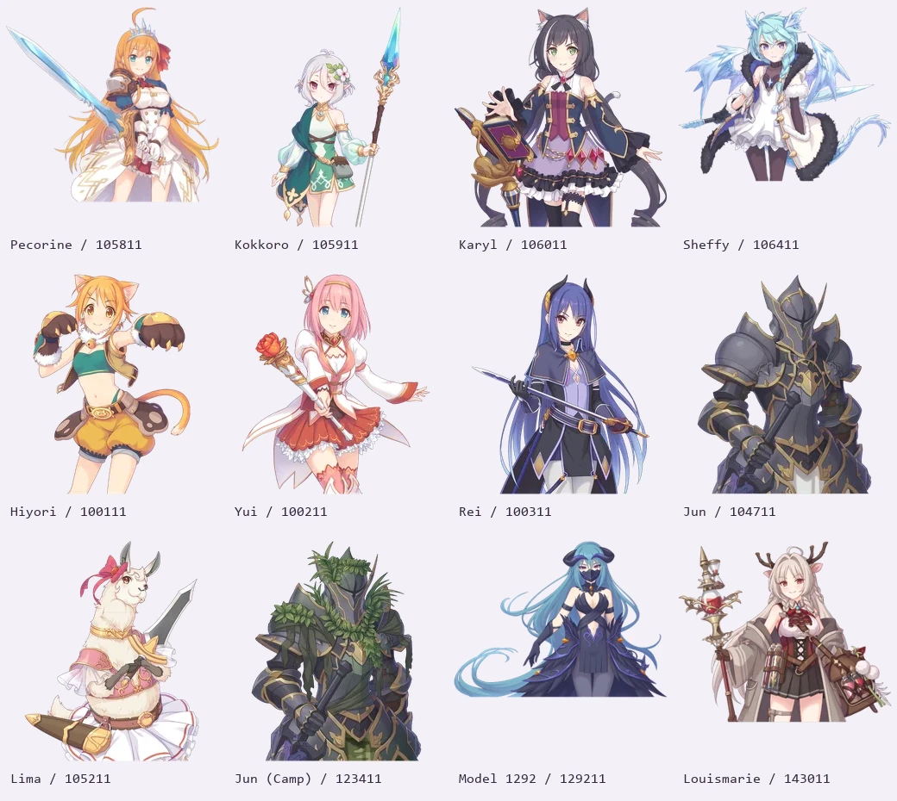
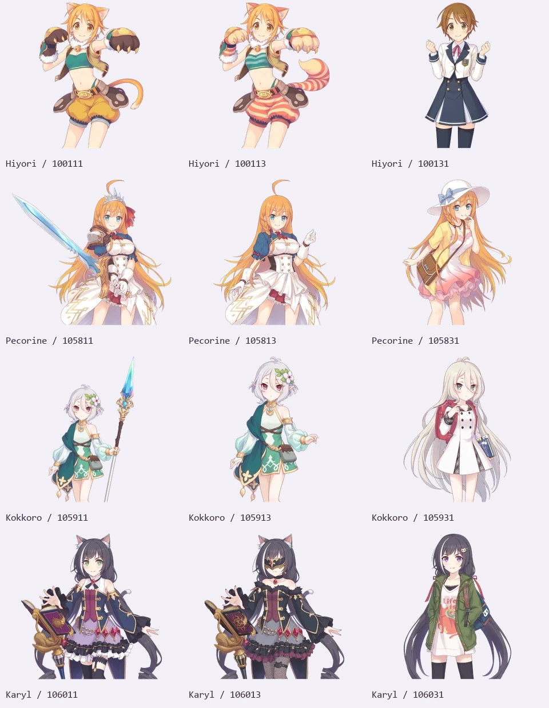
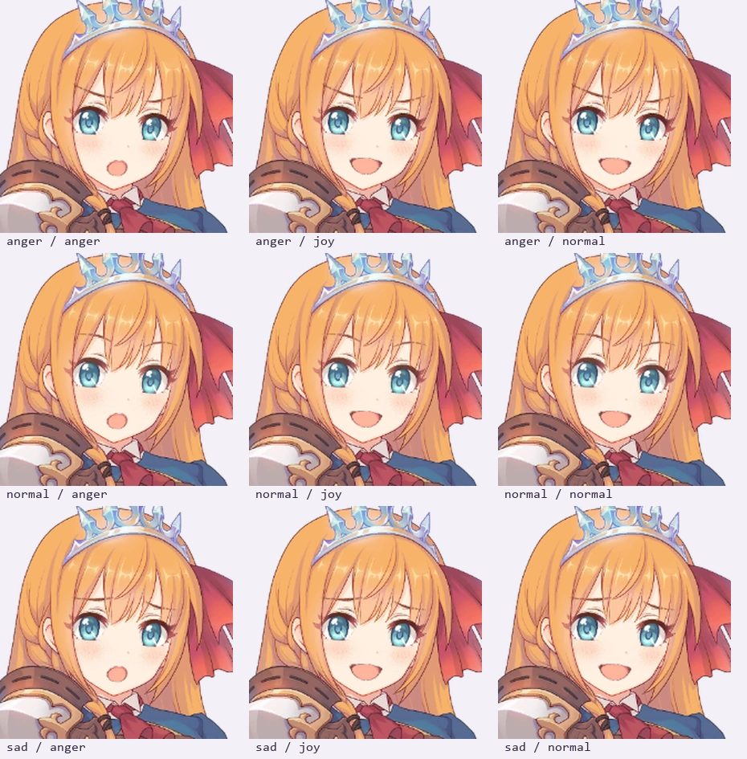

# 公主连结剧情立绘主题

新增公主连结静态立绘主题。**每个保留的剧情立绘模型各自成主题**，命名沿用 `pcr-<story-model-id>`；编号前四位是剧情批次编号而不是角色编号（同一批次里可能同时出现不同角色、吉祥物或道具），因此既不用它归并主题，也不用它当名字：角色名逐立绘取自剧情脚本的名牌，取不到名牌的立绘标题写 `Story <批次号>, <后缀>` 并带上名牌作为搜索别名。**同一个角色名、后缀十位数相同的立绘合并成一个主题**（[merge-priconne-themes.py](../scripts/merge-priconne-themes.py)）：合并主题在 `config.json` 里为每套立绘保留一个互斥的 `sets` 记录，渲染时先抽一套立绘、再在这套里挑表情，所以变化数是相加而不是相乘，卡片也不会在角色之间乱跳。十位数不同表示同一角色的另一套皮肤，不合并。无名的 `Story <批次号>` 主题要先逐个立绘确认是同一角色才合并：这些批次的四位数是剧情里的 NPC 槽位，同一个十位数经常混着不同角色（`Story 0056` 同组里就有狐耳少女、魔法师、女仆和少年），目视审计确认混角色的 13 个批次整批不合并，名单见 [priconne-merge-exceptions.json](../scripts/priconne-merge-exceptions.json)。变化数低于 10 的主题整个删除，另有 5 个立绘因为画面只有局部身体、人物偏出画框或所在分组会混角色被人工删除（被删除的编号连同此前已排除的模型记在 [priconne-excluded-themes.json](../scripts/priconne-excluded-themes.json)，共 384 条：162 条变化数低于下限、217 条此前就没有主题、5 条人工删除）。

主题覆盖两份资源清单中的角色立绘，包含剧情姿势、现实世界服装和 NPC；导出数量与验证结果见本页下方的快照验证记录。

快照验证记录：清单中 2,104 个 `spine_full` 模型去掉非立绘、未登场剪影、变化数低于 10 与人工删除的立绘后，保留 **1,490 套可见服装**并整理为 **1,026 个主题**（815 个有名角色主题与 211 个仅带名牌别名的主题，其中 298 个主题合并了 762 套同名立绘），包含 **47,088 张去重分层与 352,411 种组合**，分层 WebP 合计约 **498.4 MiB**。逐主题计数、回拼误差与资源清单 SHA-256 见 [验证记录](./priconne-validation.json)。

## 素材范围与来源

- 快照清单：[priconne-manifest.txt](../scripts/priconne-manifest.txt)，合并 `spine2` 与 `storydata2` 中的 `spine_full_<id>` / `storydata_spine_full_<id>` 资源，按模型 ID 去重后保留 2,104 条记录，包括资源路径与内容寻址 hash。相同 ID 优先使用第一份资源包；例如日和莉、佩可莉姆的图集、骨骼与身体/眼嘴配置相同，仅资源包命名不同。
- [priconne-exclusions.json](../scripts/priconne-exclusions.json) 明确列出 128 个非立绘资源（答题面板、标题特效、道具或占位项）。另删除 [priconne-silhouettes.json](../scripts/priconne-silhouettes.json) 中 102 个角色未登场半透明剪影，并按变化数下限删除 162 个主题（低于 10 个变化，不区分有名角色、反派或路人）；另有 217 个模型此前就没有独立主题（与保留立绘重复或早先已排除），以及 5 个人工确认需要删除的立绘（画面只有局部身体、人物偏出画框或所在分组会混角色）。全部未发布编号记录在 [priconne-excluded-themes.json](../scripts/priconne-excluded-themes.json)，人工增删的口径在 [priconne-merge-exceptions.json](../scripts/priconne-merge-exceptions.json)。覆盖本次清单中的目标素材，不代表全部游戏素材或未来版本。
- 公开提取工具：[lskyset/priconne-asset-extractor](https://github.com/lskyset/priconne-asset-extractor) 支持下载游戏资源清单、提取 Unity 图片与文本；[MightyZanark/PriconneUtils](https://github.com/MightyZanark/PriconneUtils) 也提供日服资源下载流程。它们是工具仓库，并非完整美术素材镜像。
- 原始资源来自游戏公开 CDN `https://prd-priconne-redive.akamaized.net/dl/pool/AssetBundles/<hash 前两位>/<hash>`。本 PR 提交处理后的静态分层，不提交 Unity 资源包或游戏数据库。
- 名称有两个来源：游戏主数据库的单位/角色记录，以及剧情脚本本身。剧情文本用 [Overseer-Council/PrincessConnectRedive_story_extraction](https://github.com/Overseer-Council/PrincessConnectRedive_story_extraction) 的命令清单（仓库里 2,165 个故事各存两份逐字节相同的拷贝，共 4,330 个文件），每个 `focus`（台词＋名牌）前最近的 `type`/`visible`/`jump`/`in_*` 参数就是该立绘的角色编号（清单里的编号去掉前导零，例如 `2711` 对应资产 `002711`）；按编号投票，只接受跨两个以上文件一致的名牌，得到逐 **立绘编号**的角色名，逐立绘的覆盖结果冻结在 [priconne-model-names.json](../scripts/priconne-model-names.json)，主数据库里只有单位记录的角色仍用 [priconne-names.json](../scripts/priconne-names.json)。罗马音与英文别名在 [priconne-romaji.json](../scripts/priconne-romaji.json) 和 [priconne-english-aliases.json](../scripts/priconne-english-aliases.json)，中文另对照 [wthee/pcr-tool-sql-diff](https://github.com/wthee/pcr-tool-sql-diff/tree/708213df9b6fe9aad632801dadc98e0ffc30cbab/cn/data/unit_data.sql) 与[公开数据库字段映射](https://github.com/wthee/pcr-tool-sql-diff/tree/708213df9b6fe9aad632801dadc98e0ffc30cbab/jp_hash)。`0027` スバル、`1000` 主人公、`1900` アメス这些只有剧情立绘的角色同样逐立绘记录；后两者没有可用的剧情名牌，属于按立绘与角色资料判断的中置信条目。
- 名牌里描述性的称呼（`男孩`、`女孩子`、`村长`、`ギャング１`、`兵士１`、`スライム（赤）` 等）不算姓名：这些主题标题写 `Story <批次号>, <后缀>`，只把名牌加进搜索别名，原模型编号也仍是搜索别名。部分名牌本身就是日文原文（`ゼーン`、`モーラ`、`ゴウシン` 等），此时中日两列都用该原文，不另做回译。编号前四位只在逐个立绘核对过时才当作角色线索：`191411` 是 `ゴウシン`（旧版按前缀错标成可可萝，已按剧情文本修正），同批次里没有名牌的立绘保持无名——`191412`/`191413` 与 `100012`、`000112` 这些虽然所在批次里有名字（或名牌是「男孩子」这类称呼），本身没有可用的姓名，因此标题仍是 `Story <批次号>, <后缀>`。
- 主题标题统一写罗马音加剧情后缀（`hiyori, 11`、`pekoriinu ( samaa ), 11`），因为部分中文译名有误，中文只作为搜索别名保留、不作为标题；罗马音来自 [priconne-romaji.json](../scripts/priconne-romaji.json)，带皮肤的角色沿用数据库里的 `名字（皮肤）` 写法。
- 原游戏美术版权归 Cygames 等各权利方所有；工具仓库的代码许可不等同于游戏美术许可。

## 分层格式与处理

每个目录包含 `ren.json`、`config.json`、`display.json`、`meta.json` 和 `ren/*.webp`。画布最长边为 640–800px，默认显示高度 400px。`ren.json[0]` 为占位项，其余层从 1 开始；范围为数组的闭区间索引。同一类别在清单中连续排列，范围内不会混入其他类别。单立绘主题的变化数就是该模型身体 × 眼睛 × 嘴巴的组合数；合并主题用 `config.json.sets`（互斥服装，渲染时先选服装再在服装内部取表情）保存每套立绘，变化数是各套组合数之和，`scripts/priconne-merged-themes.json` 记录每个合并主题由哪些立绘组成，目录名沿用其中编号最小的立绘。

导出器先将 Unity 图集的预乘 RGB 转换为普通透明度，再使用 Spine 3.6 在固定姿势、同一画布上逐个渲染部件。图集本身已含抗锯齿透明度，因此离线导出关闭额外 MSAA，避免重叠图层分开渲染时产生不同的边缘解析。透明图片按完整像素和坐标去重，以无损 WebP 保存，避免眼嘴接缝被有损压缩放大。缩放、图集旋转和裁切偏移由匹配版本的渲染器处理。

保留源模型图层顺序：通常为身体 → 眼睛 → 嘴巴；莉玛模型使用身体 → 嘴巴 → 眼睛。源素材只有身体的 NPC 或铠甲版纯 `pcr-104711` 不虚构眼嘴差分；少数只有整体变换的身体 skin 保留为身体候选。特殊表情 skin 也参与导出。

`004511`、`004512`、`004513` 三个蒙面 NPC 的源图集引用了没有随资源包提供的第二张脸部纹理页。导出时仅保留实际存在的身体页与身体附件，规则明确记录在 [priconne-source-overrides.json](../scripts/priconne-source-overrides.json)，不生成不存在的眼嘴部件。

Spine 仅用于离线素材处理。计数器运行时使用项目已有的静态 SVG 分层合成，不加载 Spine、Unity 或动画运行时。

## 重新生成

准备 Python 3.12+、Pillow、numpy、Playwright 和 Chromium：

```sh
python -m pip install Pillow numpy playwright
python -m playwright install chromium
```

用上述公开工具按清单获取并提取素材。为每个模型准备 `models/pcr-<id>/dyn.json`（Spine 3.6 JSON）、`dyn.atlas` 和图集 PNG。二进制 `.skel` 需要先通过兼容 3.6 的转换工具转为 JSON；不能用 3.8 读取器直接解释 3.6 二进制。

另行准备与 3.6.39 数据匹配的 Spine 3.6 WebGL runtime（例如 [esterTion 的 3.6 runtime 分支](https://github.com/esterTion/spine-runtimes/tree/3.6/spine-ts)），然后在仓库根目录执行：

```sh
python scripts/gen-priconne-themes.py \
  --models /path/to/models \
  --runtime /path/to/spine-3.6.js \
  --manifest scripts/priconne-manifest.txt \
  --names scripts/priconne-names.json \
  --report /tmp/priconne-report.json

python scripts/update-priconne-validation.py
python scripts/label-priconne-themes.py
```

支持 `--only 105811 105911 106011` 生成指定模型，`--partition 0 3` 分片处理，`--max-edge 640` 控制素材分辨率，以及 `--resume` 根据同一报告继续。默认读取非立绘排除清单。生成器同时输出主题库 WebP 预览图。角色搜索信息在 [priconne-themes.json](../web/app/data/priconne-themes.json)，包含中文/日文名称、罗马音与素材编号。

每个表达式都把独立分层回拼结果与整图渲染对比。透明渲染的像素舍入允许最大通道误差 8/255、整张图平均误差不超过 0.1/255；超出的模型记录为失败并在批次结束时返回非零退出码，不能算作成功导出。生成时还检查图层触及画布边缘的裁切问题。

## 验证与人工预览

```sh
go run ./cmd/check-theme
node scripts/validate-theme-meta.js
node scripts/gen-themes-json.js
go test ./internal/imgcore/...
pnpm --dir web generate
```

`TestPriconnePortraits` 从资源清单、姓名映射、[priconne-excluded-themes.json](../scripts/priconne-excluded-themes.json)、[priconne-merged-themes.json](../scripts/priconne-merged-themes.json) 与 [priconne-merge-exceptions.json](../scripts/priconne-merge-exceptions.json) 推导期望主题集合，使用真实加载器读取每个 `pcr-` 主题，检查每个立绘的类别区间、所有分层尺寸与坐标，并以不同选择验证生产懒加载合成的 SVG 格式、图层数量和组合变化。测试同时保证每个模型都落在某个主题里、合并主题的互斥集合与合并计划逐条一致、变化数不低于 10，并且变化数低于下限或被删除的主题确实已被排除。

启动开发服务后，打开 `/themes?theme=pcr-105811`，在“公主连结！Re:Dive”分组选择角色，检查计数器预览；重复请求 `/@demo?theme=pcr-105811` 可以看到不同眼嘴组合。也可检查可可萝 `pcr-105911`、凯露 `pcr-106011`、莉玛 `pcr-105211`、纯 `pcr-104711`。

剧情脚本里取到姓名的角色现在能在主题库里按名字搜到，选中后预览面板显示对应角色；`/@demo` 直接返回同一个主题的计数图：



没有取到姓名的立绘标题统一写 `Story <批次号>, <后缀>`，「男孩子」这类描述性命牌仍能搜到（只作为搜索别名）：



宽立绘在卡片与预览框里都保持水平居中，越出框外的左右两侧渐变消失，框本身的底色与圆角不受影响；比框窄的立绘保持原样，/@demo 等实际输出的计数图始终是完整图片：









相同角色的不同剧情造型独立成主题，避免跨造型随机拼出错位组合：



同一身体的独立眼睛 × 嘴巴组合（行是眼睛，列是嘴巴）：


